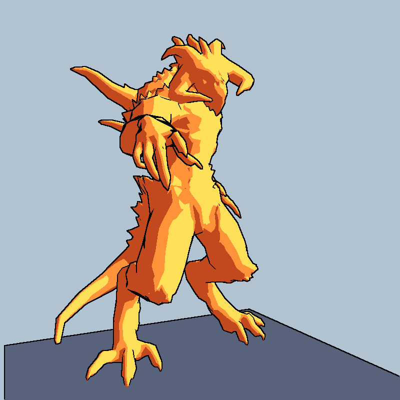
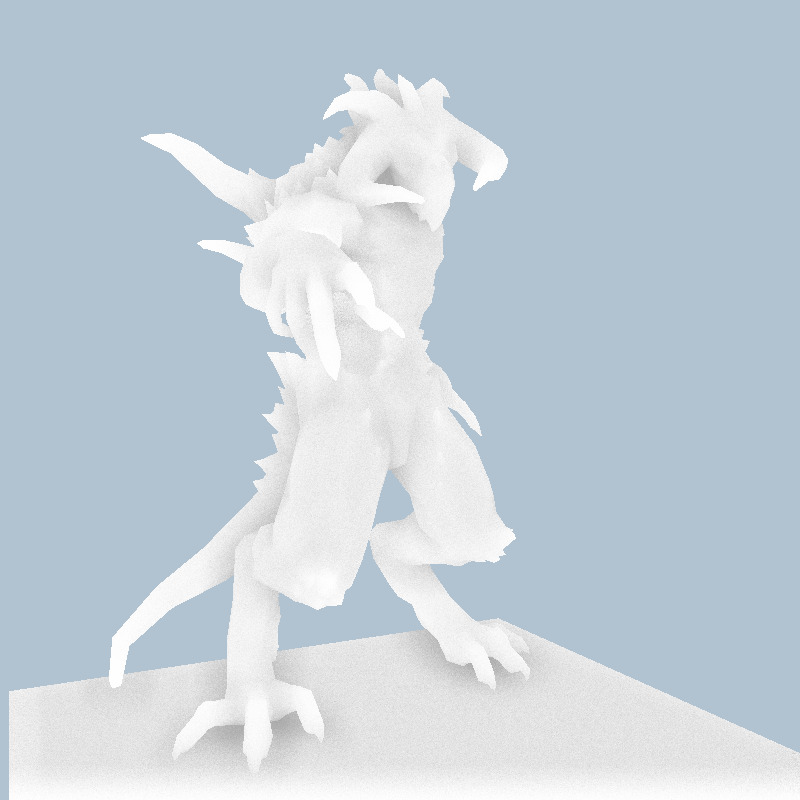
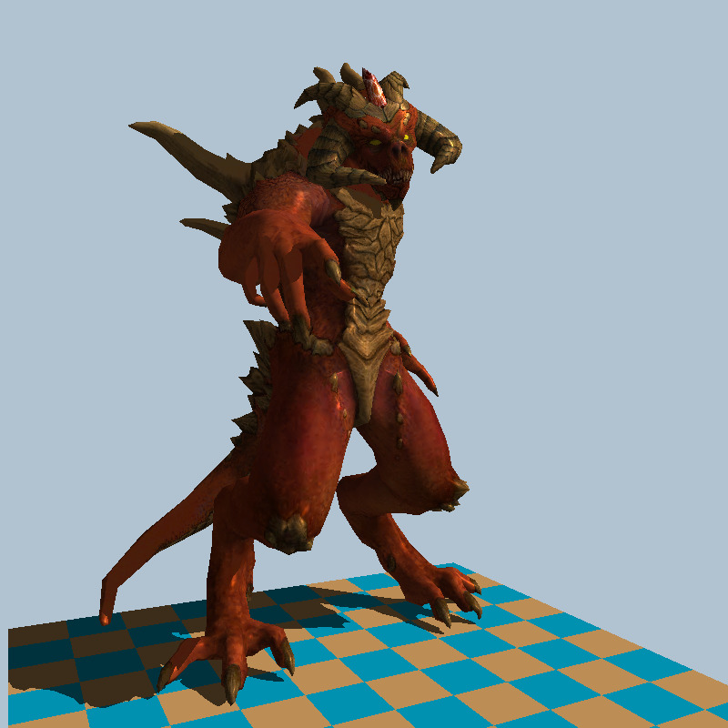
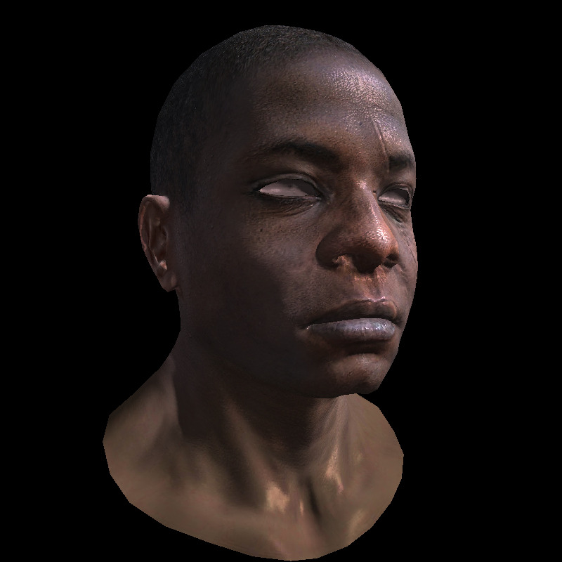

software-renderer
=================

Going through the https://haqr.eu/tinyrenderer/ software rendering tutorial in C. The main reason why I'm using C is so my code won't become out of date in the future and will still be a good reference to rendering techniques.






## Building

OpenMP support is required for building. All other dependencies are single file headers that are vendored in the repository. The project should build with a C compiler that conforms to C99 or C11. To build all the examples, run:

```
cmake . -G Ninja
ninja
```

Then you can run each day's executable, passing in the model's obj files:

```
./day13 obj/floor.obj obj/diablo3_pose.obj
```